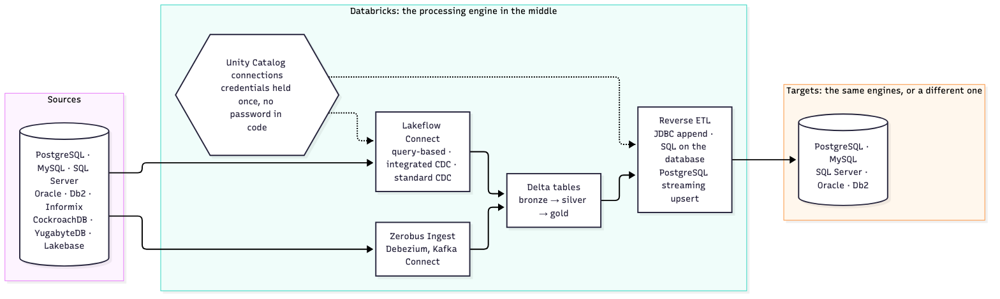
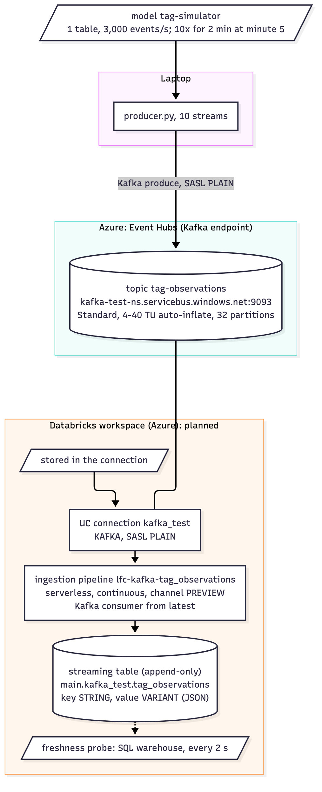
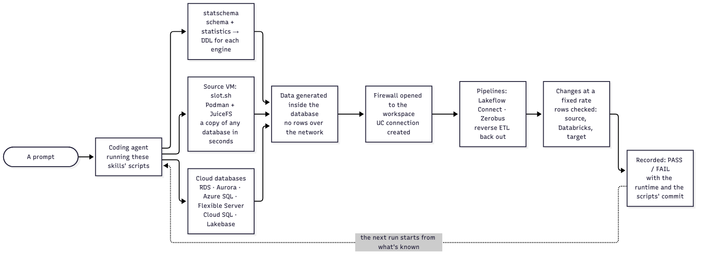

# Data into Databricks and back out, tested end to end

**Sources come into Databricks, Databricks processes them, and reverse ETL writes the result back out to a database: the same engine, or a different one.** Unity Catalog connections hold the credentials in the middle, so no password sits in code. This repo stands up real source and target databases, runs every route between them, checks the rows on both sides, and records what passed, so the next person knows what's been tested and what hasn't.



Open Claude Code (or another coding agent) in this repo, with a Databricks CLI login, and ask in plain words:

> Set up a SQL Server 2022 source with TPC-C data and ingest it into Databricks with Lakeflow Connect. Build daily order totals in Databricks, write them into a PostgreSQL database through a Unity Catalog connection with no password in code, and check the rows on both sides.

The skills ask before creating anything, and clean up after themselves. To run the tests as scripts instead, see [docs/running-tests.md](docs/running-tests.md).

## Install

In Claude Code, from any folder, with no clone:

```
/plugin marketplace add rsleedbx/databricks-agent-skills-tests
/plugin install lfc-tests@lfc-tests
```

**Update often:** the skills change every few days. Before a test, get the latest, then restart Claude Code:

```
/plugin marketplace update lfc-tests
/plugin update lfc-tests@lfc-tests
```

Each commit is a new version (the plugin has no fixed version number), so an update always brings what's on `main`.

From a terminal, the same with `claude plugin marketplace add rsleedbx/databricks-agent-skills-tests`, `claude plugin install lfc-tests@lfc-tests`, `claude plugin marketplace update lfc-tests` and `claude plugin update lfc-tests@lfc-tests`. The public Lakeflow Connect skill the tests use comes from the Databricks plugin: `/plugin marketplace add databricks/databricks-agent-skills`, then `/plugin install databricks@databricks-agent-skills`.

Then ask in plain words, as above. Each session starts by naming any tool the tests need that isn't installed (Databricks CLI, uv, jq, yq, DuckDB, Podman, and Lima on macOS); ask *"check the tools for local tests"* for the install commands ([check-tools.sh](skills/cli-setup/scripts/check-tools.sh)). Results you record go to `~/.lfc/tests/results/` (or `$LFC_TESTS_RESULTS`), next to the ones shipped with the plugin; to add yours to this repo, open a pull request from a clone ([CONTRIBUTING.md](CONTRIBUTING.md)).

## What's tested, by route

| Route | What each page shows |
|---|---|
| [Lakeflow Connect, by database](docs/lakeflow-connect-database.md) | Query-based, integrated CDC and standard CDC on PostgreSQL, MySQL, SQL Server, Oracle and Lakebase; schema changes and table lifecycle |
| [Lakeflow Connect Zerobus](docs/lakeflow-connect-zerobus.md) | Database changes through Zerobus Ingest into bronze, silver and gold, on eight engines, six of them with all six TPC models |
| [Reverse ETL](docs/reverse-etl.md) | Append, SQL on the database, and upserts back out to PostgreSQL, MySQL, SQL Server, Oracle and Db2; into Lakebase with its streaming sink and synced tables |

## How a prompt becomes a tested result

Three steps, shown with one real run: Kafka into Databricks through the Lakeflow Connect Kafka connector, timed end to end ([results/2026-11-03-lfc-kafka-laptop.md](results/2026-11-03-lfc-kafka-laptop.md)).

### 1. Ask for the experiment

> Measure how fresh Kafka events are in Databricks through Lakeflow Connect: an Event Hubs broker in my resource group, 3,000 events/s from my laptop with a 10x burst for 2 minutes, and report freshness before, during and after the burst. Clean up only what you create.

The skills read the settings asked once on the first run (subscription, region, resource group, workspace: [lfc-test-settings](skills/lfc-test-settings/SKILL.md)) instead of asking again.

### 2. See the plan as a diagram, before anything is created

Every component the run will create, drawn from the pipeline spec and the connection before either exists ([lfc-pipeline-diagram](skills/lfc-pipeline-diagram/SKILL.md)). Nothing is created until you agree; after the create, the same drawing is made from what exists, so the two can be compared.



### 3. Run it, fix what comes up, record the result



- **A fresh copy of any database, in a fraction of a second**, on a VM (Podman and JuiceFS), or a cloud database (RDS, Aurora, Azure SQL, Flexible Server, Cloud SQL, Lakebase).
- **Data generated inside the database, from any schema**, shaped like a customer's from its statistics only ([statschema](https://github.com/rsleedbx/statschema)); only the SQL travels.
- **Scripts, not instructions:** each skill runs the scripts in its own `scripts/` folder, so anyone can repeat a test without the AI, and a ✅ means "these scripts, at this commit".
- **Answers tested as claims, on the runtime they ran on:** each result is a rerunnable PASS or FAIL tied to the runtime and settings of every update.

What came up in the example run, and what was changed so the next run doesn't hit it:

| What happened | Fixed by |
|---|---|
| The workspace's login had expired | a token from the Azure CLI login ([account-token-fallback](skills/account-token-fallback/SKILL.md)); no login asked |
| The broker script would have run `az group create` on the user's existing group, which replaces its tags | the script now needs an existing group, never creates, re-tags or deletes one, and deletes only the namespace it tagged ([lfc-source-eventhubs](skills/lfc-source-eventhubs/SKILL.md)) |
| The workspace had no SQL warehouse for the freshness probe | a small serverless one, created for the run and deleted after |
| The diagram drew the Kafka connection as a SaaS API | Kafka added to the diagram (broker, topic, consumer) |
| 330 more rows landed than were sent | the producer now counts the duplicates it sends on purpose, so the report shows lost events and extra copies apart |

The result: the 10x burst reached 29,938 events/s; freshness p50 3.9 s, p90 5.3 s; recorded with `record.py`, and everything the run made removed.

How these compare with other tools, and their limits: [docs/what-is-unique.md](docs/what-is-unique.md).

## How to use this repo

The test space is large: where the source runs, the database and version, the ingestion mode, the cloud and kind of workspace, compute, network path, storage and data size. Nobody can run every combination, so the repo works like a shared notebook:

1. **Check what's already known:** `uv run skills/lfc-test-results/scripts/recall.py --coverage`, or the summary in [docs/coverage.md](docs/coverage.md); and what's been found for the combination: `uv run skills/lfc-test-results/scripts/finding.py --source <engine> --route <route>`.
2. **Pick what to cover,** preferably values nobody has tested yet ([test-matrix.md](skills/lfc-test-results/references/test-matrix.md)).
3. **Run** the deploy matrix against one workspace, or one skill's own test ([docs/running-tests.md](docs/running-tests.md)).
4. **Record** each result with `record.py`. Records are per run, so people testing in parallel never edit the same file.

## More

- [A skill for each step of the test and validation journey](docs/test-and-validation-journey.md): sources on every cloud or a laptop, the firewall, the four ingestion modes, data at size, database copies in seconds, changes, schema changes, Zerobus, and the runtime each test ran on.
- [Numbers from the tests](docs/numbers-from-the-tests.md): branch and read/write times, 110M rows generated inside the database, change events half the size, how long the schema-change tests take.
- [docs/lakeflow-connect-zerobus.md](docs/lakeflow-connect-zerobus.md): Lakeflow Connect Zerobus, tested end to end by database, with every successful run.
- [docs/zerobus-debezium.md](docs/zerobus-debezium.md): database changes through Debezium and Zerobus into bronze, silver and gold, what was checked, and the prompts to run it again.
- [docs/lakeflow-connect-database.md](docs/lakeflow-connect-database.md): the prompts that reproduce each cell of the table, and what they create, in order.
- [docs/coverage.md](docs/coverage.md): every axis tested, what the product refuses by design, and what's not tested yet.
- [docs/findings.md](docs/findings.md): what the tests turned up, by source, route, layer and topology, with the fix or workaround for each: look up a combination before building it.
- [docs/layers.md](docs/layers.md): which layer each skill is in (common, shape, contract, sources, lakeflow), what each may use, and the check that keeps the references one way ([layers.yaml](layers.yaml), [bin/check_layers.py](bin/check_layers.py)).
- [docs/running-tests.md](docs/running-tests.md): setup, the deploy matrix, schema-change and script tests, recording results.
- [MATRIX.md](MATRIX.md): every deploy-test cell and its pass criteria.
- [skill-token-budget](.claude/skills/skill-token-budget/SKILL.md): how to write a skill so an agent loads few tokens (SKILL.md under 5k tokens, detail in references/, scripts run from their usage line), and the checks that enforce it.
- [public-skill-conventions](.claude/skills/public-skill-conventions/SKILL.md): what the public Databricks skills do (frontmatter, file and section names, error tables, links, release stages, no test-report wording, the generated bundle, version, sign-off), and `conventions-check.py`, which compares one skill with all the others.
- [SCRIPTS.md](SCRIPTS.md): every script under `skills/` and `bin/`, one line each (path and usage), generated from the scripts' headers. Find a script there, then run it with no arguments for its usage instead of reading it.
- The repo also tests the [databricks-agent-skills](https://github.com/databricks/databricks-agent-skills) with headless Claude Code sessions: does a prompt reach the right skill, does the skill ask before creating anything, and does what it builds work. See [docs/running-tests.md](docs/running-tests.md#guidance-tests).
- UI walkthroughs of the Lakeflow Connect wizard, as masked screenshots: [ui-demos/](ui-demos/) ([lfc-ui-capture](skills/lfc-ui-capture/SKILL.md)).

## License

[Databricks License](LICENSE); third-party parts are listed in [NOTICE](NOTICE). Security reports: [SECURITY.md](SECURITY.md). Contributing: [CONTRIBUTING.md](CONTRIBUTING.md).
