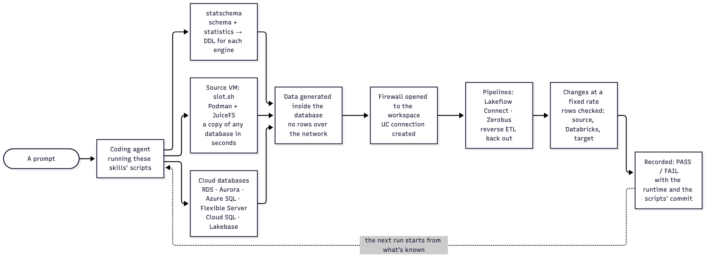

# Data into Databricks and back out, tested end to end

**Sources come into Databricks, Databricks processes them, and reverse ETL writes the result back out to a database: the same engine, or a different one.** Unity Catalog connections hold the credentials in the middle, so no password sits in code. This repo stands up real source and target databases, runs every route between them, checks the rows on both sides, and records what passed, so the next person knows what's been tested and what hasn't.

Open Claude Code (or another coding agent) in this repo, with a Databricks CLI login, and ask in plain words:

> Set up a SQL Server 2022 source with TPC-C data and ingest it into Databricks with Lakeflow Connect. Build daily order totals in Databricks, write them into a PostgreSQL database through a Unity Catalog connection with no password in code, and check the rows on both sides.

The skills ask before creating anything, and clean up after themselves. To run the tests as scripts instead, see [docs/running-tests.md](docs/running-tests.md).

## What's tested, by route

| Route | What each page shows |
|---|---|
| [Lakeflow Connect, by database](docs/lakeflow-connect-database.md) | Query-based, integrated CDC and standard CDC on PostgreSQL, MySQL, SQL Server, Oracle and Lakebase; schema changes and table lifecycle |
| [Lakeflow Connect Zerobus](docs/lakeflow-connect-zerobus.md) | Database changes through Zerobus Ingest into bronze, silver and gold, on eight engines, six of them with all six TPC models |
| [Reverse ETL](docs/reverse-etl.md) | Append, SQL on the database, and upserts back out to PostgreSQL, MySQL, SQL Server, Oracle and Db2; into Lakebase with its streaming sink and synced tables |

## How a prompt becomes a tested result

- **A fresh copy of any database, in a fraction of a second**, on a VM (Podman and JuiceFS), or a cloud database (RDS, Aurora, Azure SQL, Flexible Server, Cloud SQL, Lakebase).
- **Data generated inside the database, from any schema**, shaped like a customer's from its statistics only ([statschema](https://github.com/rsleedbx/statschema)); only the SQL travels.
- **Scripts, not instructions:** each skill runs the scripts in its own `scripts/` folder, so anyone can repeat a test without the AI, and a ✅ means "these scripts, at this commit".
- **Answers tested as claims, on the runtime they ran on:** each result is a rerunnable PASS or FAIL tied to the runtime and settings of every update.

How these compare with other tools, and their limits: [docs/what-is-unique.md](docs/what-is-unique.md).

## How to use this repo

The test space is large: where the source runs, the database and version, the ingestion mode, the cloud and kind of workspace, compute, network path, storage and data size. Nobody can run every combination, so the repo works like a shared notebook:

1. **Check what's already known:** `uv run skills/lfc-test-results/scripts/recall.py --coverage`, or the summary in [docs/coverage.md](docs/coverage.md); and what's been found for the combination: `uv run skills/lfc-test-results/scripts/finding.py --source <engine> --route <route>`.
2. **Pick what to cover,** preferably values nobody has tested yet ([test-matrix.md](skills/lfc-test-results/references/test-matrix.md)).
3. **Run** the deploy matrix against one workspace, or one skill's own test ([docs/running-tests.md](docs/running-tests.md)).
4. **Record** each result with `record.py`. Records are per run, so people testing in parallel never edit the same file.

## More

- [A skill for each step of the test and validation journey](docs/test-and-validation-journey.md): sources on every cloud or a laptop, the firewall, the four ingestion modes, data at size, database copies in seconds, changes, schema changes, Zerobus, and the runtime each test ran on.
- [Numbers from the tests](docs/numbers-from-the-tests.md): branch and read/write times, 110M rows generated inside the database, change events half the size, how long the schema-change tests take.
- [docs/lakeflow-connect-zerobus.md](docs/lakeflow-connect-zerobus.md): Lakeflow Connect Zerobus, tested end to end by database, with every successful run.
- [docs/zerobus-debezium.md](docs/zerobus-debezium.md): database changes through Debezium and Zerobus into bronze, silver and gold, what was checked, and the prompts to run it again.
- [docs/lakeflow-connect-database.md](docs/lakeflow-connect-database.md): the prompts that reproduce each cell of the table, and what they create, in order.
- [docs/coverage.md](docs/coverage.md): every axis tested, what the product refuses by design, and what's not tested yet.
- [docs/findings.md](docs/findings.md): what the tests turned up, by source, route, layer and topology, with the fix or workaround for each: look up a combination before building it.
- [docs/running-tests.md](docs/running-tests.md): setup, the deploy matrix, schema-change and script tests, recording results.
- [MATRIX.md](MATRIX.md): every deploy-test cell and its pass criteria.
- [skill-token-budget](skills/skill-token-budget/SKILL.md): how to write a skill so an agent loads few tokens (SKILL.md under 5k tokens, detail in references/, scripts run from their usage line), and the checks that enforce it.
- [public-skill-conventions](skills/public-skill-conventions/SKILL.md): what the public Databricks skills do (frontmatter, file and section names, error tables, links, release stages, no test-report wording, the generated bundle, version, sign-off), and `conventions-check.py`, which compares one skill with all the others.
- [SCRIPTS.md](SCRIPTS.md): every script under `skills/` and `bin/`, one line each (path and usage), generated from the scripts' headers. Find a script there, then run it with no arguments for its usage instead of reading it.
- The repo also tests the [databricks-agent-skills](https://github.com/databricks/databricks-agent-skills) with headless Claude Code sessions: does a prompt reach the right skill, does the skill ask before creating anything, and does what it builds work. See [docs/running-tests.md](docs/running-tests.md#guidance-tests).
- UI walkthroughs of the Lakeflow Connect wizard, as masked screenshots: [ui-demos/](ui-demos/) ([lfc-ui-capture](skills/lfc-ui-capture/SKILL.md)).
