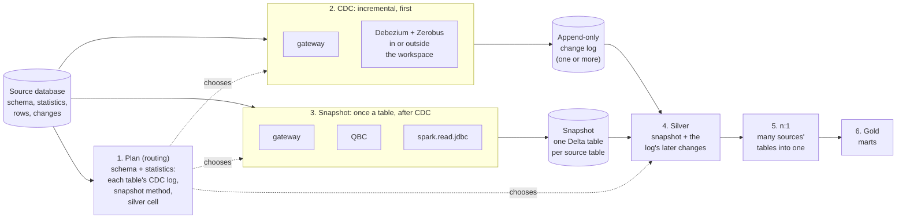

# FlowThrough: from source changes to gold

FlowThrough is intelligent, low latency, high throughput, scales to 10,000s of tables and supports n:1 fan-in. Best of
all, there is never a full table refresh, by design.

- **Intelligent:** table relationships and database statistics decide whether each table is a dimension, a fact or
  realtime, and give it the snapshot and silver that fit. [design-intelligent.md](design-intelligent.md)
- **Latency:** Zerobus writes each change straight into the log, or a gateway's files are copied in once each; the
  busiest tables are kept by AUTO CDC in a continuous pipeline. [design-transport.md](design-transport.md)
- **Throughput:** one append-only log per transport, clustered by table; a table busy enough to slow the others gets
  a log of its own, sharded by key. [design-transport.md](design-transport.md)
- **Scale:** small tables share one table of changes and one MERGE a round, with a view each; big ones get a MERGE of
  their own or AUTO CDC. [design-scale.md](design-scale.md)
- **Fan-in:** each source (a line of business, a tenant, a region) into one table each, whatever transport or silver
  method it came through. [design-fanin.md](design-fanin.md)
- **No full refresh:** the source is read once a table; a schema change is an event at its position, a suspect part is
  re-read alone, and a checkpoint resnapshots from silver. [design-no-full-refresh.md](design-no-full-refresh.md)

FlowThrough is a technique, not a package: six layers, each with many sources or ways in, and no layer depends on
another's choices.

Two contracts hold it together. Every CDC source writes the same append-only change log (`_op`, `_seq`, a watermark),
and every snapshot method writes the same thing: one Delta table per source table, with the source's columns and types.
So silver never knows which transport or snapshot method a table came through, and Debezium through Zerobus is the same
CDC source whether it runs in the workspace or outside it.

| Layer | What it does | Detail | Skill |
|---|---|---|---|
| 1. Routing | first, the plan: the schema, the statistics and the tables in scope decide each table's CDC log, snapshot method and first silver cell; then every round, its measured rate moves it | [design-intelligent.md](design-intelligent.md) | lfc-routing `routing`, lfc-log-silver `flowthrough` |
| 2. CDC | every source's changes (Zerobus, a gateway, a changefeed, ...) into one shape: an append-only change log, changes only | [design-transport.md](design-transport.md) | lfc-change-source |
| 3. Snapshot | every table's rows once, by the method routing chose (a direct JDBC read, QBC, a gateway's own, the customer's files), into a Delta table of its own, after its CDC has started | [design-no-full-refresh.md](design-no-full-refresh.md) | lfc-change-source (`qbc`, `intake`) |
| 4. Silver | combines them: the snapshot table and the log's changes after it, kept by the cell routing chose (view, shared group, MERGE, AUTO CDC) | [design-scale.md](design-scale.md) | lfc-log-silver `silver` |
| 5. n:1 | many sources' tables into one | [design-fanin.md](design-fanin.md) | lfc-medallion |
| 6. Gold | marts on the n:1 tables | [design-fanin.md](design-fanin.md) | lfc-medallion-pack |

So the cases add up instead of multiplying: a new CDC source is one row in layer 2, a new snapshot source one row in
layer 3, a new kind of table one cell in silver.

Where the code doesn't meet this design yet, and what has been tested: [design-audit.md](design-audit.md).
