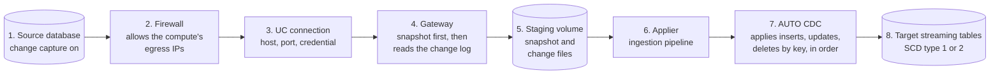
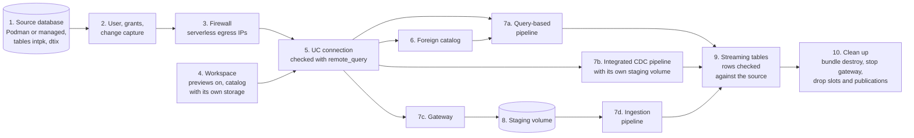

# Lakeflow Connect database: reproduce the tests

Every ✅ below ran end to end in a real workspace: source database, UC connection, pipeline, and the rows checked against the source. Each linked cell is the prompt that ran it; give it to Claude Code (or another coding agent with the [databricks-agent-skills](https://github.com/databricks/databricks-agent-skills) and a Databricks CLI login) to run it again. Back to the [README](../README.md).

| Database | UC connection, queried with [`remote_query`](https://docs.databricks.com/aws/en/query-federation/remote-queries) | Query-based | Query-based via foreign catalog | Integrated CDC | Standard CDC (gateway) |
|---|---|---|---|---|---|
| Lakebase | ✅ Azure | [✅ Azure, with a DML round trip](../prompts/lfc-matrix/qbc-lakebase.txt) | [✅ Azure](../prompts/lfc-matrix/fcqbc-lakebase.txt) | not offered | ✅ AWS (serverless gateway), by hand: source type `POSTGRESQL`, a password role, the project's password connections turned on |
| MySQL 8.4 | ✅ AWS, Azure | [✅ AWS, Azure](../prompts/lfc-matrix/qbc-mysql.txt) | [✅ AWS, Azure](../prompts/lfc-matrix/fcqbc-mysql.txt) | [✅ AWS, Azure](../prompts/lfc-matrix/icdc-mysql.txt) | ✅ AWS (serverless gateway); not enabled on the Azure test workspaces |
| Oracle 23ai Free | ✅ AWS, Azure | [✅ AWS, Azure](../prompts/lfc-matrix/qbc-oracle.txt) | [✅ AWS, Azure](../prompts/lfc-matrix/fcqbc-oracle.txt) | [✅ AWS, Azure](../prompts/lfc-matrix/icdc-oracle.txt) | not offered |
| PostgreSQL 16 | ✅ AWS, Azure | [✅ AWS, Azure](../prompts/lfc-matrix/qbc-pg.txt) | [✅ AWS, Azure](../prompts/lfc-matrix/fcqbc-pg.txt) | not offered | ✅ AWS (serverless gateway); not enabled on the Azure test workspaces |
| SQL Server 2022 | ✅ AWS, Azure | [✅ AWS, Azure](../prompts/lfc-matrix/qbc-sqlserver.txt) | [✅ AWS, Azure](../prompts/lfc-matrix/fcqbc-sqlserver.txt) | [✅ AWS, Azure](../prompts/lfc-matrix/icdc-sqlserver.txt) | [✅ AWS, Azure (serverless gateway)](../prompts/lfc-matrix/scdc-sqlserver.txt) |

The UC connection column has no prompt of its own: the connection comes from step 5 below, and every mode's prompt starts from it. Lakebase runs from one bare "demo" prompt that creates its own project, connection and pipeline ([qbc-lakebase.txt](../prompts/lfc-matrix/qbc-lakebase.txt)). What each cell must show to pass is in [MATRIX.md](../MATRIX.md#pass-criteria-every-cell).

## Schema changes and table lifecycle, by database

Each ✅ ran on a fresh source database and real pipelines, with the destination checked against the source; the test then recovered the table (full refresh or `auto_full_refresh_policy`) and checked the next change arrived. Scripts: [skills/lfc-schema-change-test](../skills/lfc-schema-change-test/SKILL.md).

| Scenario | SQL Server, standard CDC | SQL Server, integrated CDC | PostgreSQL 16, standard CDC |
|---|---|---|---|
| ADD COLUMN (nullable, default, identity, computed; keyed and keyless) | ✅ | ✅ | ✅ |
| Type change, DROP COLUMN, rename, primary key change | ✅ | | ✅ |
| `auto_full_refresh_policy` recovers a stopped table | ✅ | | ✅ |
| DELETE every row + INSERT | ✅ | ✅ | |
| TRUNCATE (CDC and change tracking) | ✅ | ✅ | ✅ |
| DROP and recreate a table | ✅ | ✅ | |
| Add a table to a running pipeline | ✅ | ✅ | |
| Replica identity DEFAULT / FULL / NOTHING, TOAST-able columns | | | ✅ |
| Permissions missing, table not tracked; the other tables keep loading | ✅ | | |
| SCD type 2 on change tracking and CDC | ✅ | ✅ | |
| Change data feed on the destination (`table_changes`) | ✅ | | |
| Move between integrated CDC and a gateway | ✅ | ✅ | |
| Many tables in one pipeline (90, 270, 900; TPC-C copies, one schema each) | ✅ | | |

## How Lakeflow Connect moves the data



1. **Source database.** Change capture is on: SQL Server change tracking or CDC, the MySQL binlog, a Postgres publication and replication slot, or Oracle LogMiner. The source has a user with read access and the grants the connector needs.
2. **Firewall.** The source accepts connections from the compute that reads it. On serverless, that's the workspace's serverless egress IP ranges; on classic, the classic compute's egress IP.
3. **UC connection.** A Unity Catalog connection holds the host, port and credential. Every pipeline reads the source through it, and `remote_query` checks it before anything else is built.
4. **Gateway.** It takes the snapshot of each table, then keeps reading the source's change log from the position it recorded before the snapshot.
5. **Staging volume.** A Unity Catalog volume between the two halves: the snapshot as Parquet files, and the changes as files the applier reads.
6. **Applier.** The ingestion pipeline reads the staging volume, one flow per table.
7. **AUTO CDC.** It applies the snapshot, then every insert, update and delete by the table's key, in source order, so late or repeated changes don't corrupt the table.
8. **Target streaming tables.** One per source table: the current rows (SCD type 1) or every version of each row (SCD type 2).

How the modes differ:

- **Standard CDC:** the gateway (4) is its own pipeline and runs continuously. The applier (6) is a second pipeline that runs on a schedule.
- **Integrated CDC:** one pipeline does 4 to 7 in each update. It extracts to its own staging volume, then applies from it, so there's no separate gateway to run.
- **Query-based:** no gateway and no change log (no 4 or 5). Each run queries the source through the connection for rows past a cursor column, such as an update timestamp, and applies them (7). Through a foreign catalog, it reads the same way, with the foreign catalog's tables as the source.

## What gets created, in order



Steps 1–3 happen once per source, step 4 once per workspace, and step 5 once per source and workspace. Steps 6–10 happen for each mode: query-based (7a, through a foreign catalog with 6), integrated CDC (7b, which extracts to its own staging volume and applies from it), or standard CDC (a gateway, 7c, writes the staging volume and an ingestion pipeline, 7d, applies it). Each mode also makes its destination schema, and CDC a staging schema. Clean up (10) runs `databricks bundle destroy`, stops a gateway and drops Postgres slots and publications. Each mode's prompt makes its own pipeline, schema and bundle, so the modes can run one after another on the same connection.

## The prompts, step by step

Each prompt is written the way you'd say it. The skills ask before creating anything; answer, then say yes. The prompt files use `${VAR}` placeholders that `env.sh` fills from your private `env.local.sh` (profiles, catalog, connection names), so nothing workspace-specific is in this repo.

**1–2. A source database, with change capture on** ([lfc-source-setup](../skills/lfc-source-setup/SKILL.md)):

> Set up a SQL Server 2022 source in Podman on an Azure VM for Lakeflow Connect, with the test tables intpk and dtix, change tracking on intpk and CDC on dtix, and a login for Lakeflow Connect.

The same request works for MySQL 8.4, PostgreSQL 16 or Oracle 23ai Free, and for a managed service ("an Azure SQL Database", "an RDS for MySQL instance") instead of Podman. To make it bigger, add "and fill it with TPC-C at scale factor 1" ([lfc-source-statschema](../skills/lfc-source-statschema/SKILL.md)).

**3. The firewall** ([lfc-source-firewall](../skills/lfc-source-firewall/SKILL.md)):

> Open that source's firewall to the serverless egress IPs of the workspace for Databricks CLI profile <profile>, and to my IP.

**4. The workspace** ([lfc-workspace-setup](../skills/lfc-workspace-setup/SKILL.md)):

> Check the workspace for profile <profile> for Lakeflow Connect: turn on the connector previews it needs, and pick a target catalog that CDC accepts.

**5. The UC connection** ([lfc-connection-sync](../skills/lfc-connection-sync/SKILL.md)):

> Create a Unity Catalog SQLSERVER connection to that source in the workspace for profile <profile>, and check it with remote_query.

**6–9. One pipeline per mode** (7a–7d in the diagram). These are the matrix prompts, two turns each. With your names filled in:

- **Query-based** ([qbc-sqlserver.txt](../prompts/lfc-matrix/qbc-sqlserver.txt)):
  > Set up a Lakeflow Connect query-based ingestion pipeline from the existing connection <connection> in the workspace for Databricks CLI profile <profile>.

  > Use the source tables intpk and dtix in database <database>, schema <schema>. intpk: SCD_TYPE_1, primary key pk, cursor dt. dtix: APPEND_ONLY, cursor dt. Target catalog <catalog>, new schema t_sqlserver_qbc. No schedule. Yes, create everything, run it once, then show the rows per table per run report.
- **Query-based through a foreign catalog** ([fcqbc-sqlserver.txt](../prompts/lfc-matrix/fcqbc-sqlserver.txt)):
  > Set up a Lakeflow Connect query-based ingestion pipeline that reads through a Lakehouse Federation foreign catalog for the connection <connection>, in the workspace for Databricks CLI profile <profile>.

  The second turn is the same as above, plus "including the foreign catalog if there isn't one for this connection".
- **Integrated CDC** ([icdc-sqlserver.txt](../prompts/lfc-matrix/icdc-sqlserver.txt)):
  > Set up Lakeflow Connect CDC from the existing connection <connection> in the workspace for Databricks CLI profile <profile>.

  > Use the source tables intpk and dtix in database <database>, schema <schema>, both SCD_TYPE_1. Target catalog <catalog>, new schema t_sqlserver_icdc, staging schema t_sqlserver_icdc_stg. No schedule. Yes, create everything and start the first update without waiting for it to finish. Tell me the pipeline ID and update ID, and show the rows per table per run report so far.
- **Standard CDC, with a gateway** ([scdc-sqlserver.txt](../prompts/lfc-matrix/scdc-sqlserver.txt)):
  > Set up Lakeflow Connect standard CDC, the two-pipeline setup with a gateway, from the existing connection <connection> in the workspace for Databricks CLI profile <profile>.

  The second turn is like integrated CDC's, with a gateway staging schema, plus "start the gateway, run the ingestion pipeline once".
- **Lakebase, from nothing** ([qbc-lakebase.txt](../prompts/lfc-matrix/qbc-lakebase.txt)): "set up a lakeflow connect demo in the workspace for Databricks CLI profile <profile>". It creates the Lakebase project, the seed tables, a reader role, the connection and the pipeline.
- **Changes arrive** ([dml-lakebase.txt](../prompts/lfc-matrix/dml-lakebase.txt)): from only the pipeline name, the skill reads the source's tables through the connection and generates 10 inserts, 10 updates and 10 deletes per table. It runs them, runs the pipeline, and shows that the changes arrived.

**10. Clean up.** Each skill offers it at the end: `databricks bundle destroy`, stop a standard CDC gateway, and drop any Postgres slot or publication. Check that it ran.

## Run the whole table at once

```bash
cp env.example.sh env.<name>.local.sh     # once per workspace: profiles, catalog, connections
LFC_ENV=<name> source env.sh
bin/run_matrix.sh                         # query-based, foreign catalog, integrated, standard CDC, then DML
```

It runs one mode at a time, so tests on the same connection don't race, then reports what compute each pipeline ran on. Details and options: [MATRIX.md](../MATRIX.md#running-it) and [running-tests.md](running-tests.md#deploy-tests-the-lakeflow-connect-matrix). Record each cell with `record.py` ([lfc-test-results](../skills/lfc-test-results/SKILL.md)), and it shows in the coverage the next person checks.
