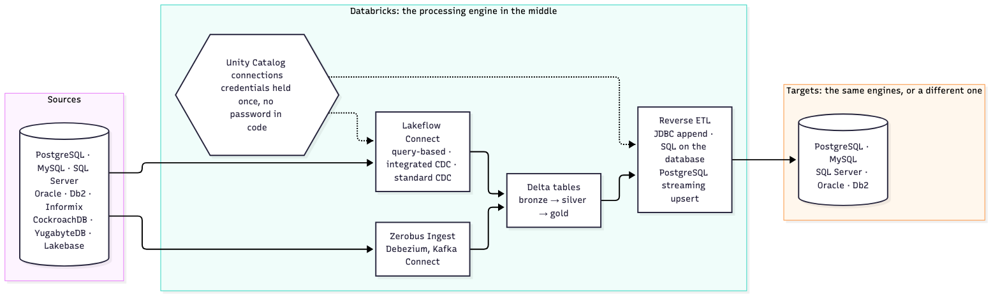

# Reverse ETL: data from Databricks back out to a database, tested end to end

Reverse ETL writes data that Databricks processed into an operational database, the same engine it came from or a different one. Every route here goes through a Unity Catalog connection, so the database's password sits in the connection, never in code.

## Tested end to end, by database

Each ✅ ran on Databricks serverless against a real database, with the rows checked on the database afterwards. "By hand" means it ran from a notebook, not from a script in this repo yet.

| Database | Append rows (`format("jdbc")`, TYPE JDBC connection) | SQL on the database (`sessionInitStatement`): insert, update, delete at a capped rate | Upsert new and changed rows (`writeStream.format("postgresql")`) | Read back with `remote_query` on a serverless SQL warehouse | Verify the server's certificate (`userProvidedServerCertificate`) |
|---|---|---|---|---|---|
| PostgreSQL 16 | ✅ | ✅ | ✅ by hand (POSTGRESQL connection, `AvailableNow`) | ✅ by hand | ✅ by hand, with `sslfactory=org.postgresql.ssl.DefaultJavaSSLFactory` |
| MySQL 8.4 | ✅ | ✅ (`allowMultiQueries=true`) | not offered (PostgreSQL only) | not run | ❌ by hand: `VERIFY_CA` failed with the certificate as without it |
| SQL Server 2022 | ✅ | ✅ | not offered (PostgreSQL only) | not run | not run |
| Oracle 23 Free | not run | ✅ | not offered (PostgreSQL only) | not run | not run |
| Db2 11.5.9 | not run | ✅ | not offered (PostgreSQL only) | not run | not run |

## The routes

- **Append rows:** `df.write.format("jdbc").option("databricks.connection", ...).mode("append")`. Needs a connection of type `JDBC` (a Lakehouse Federation type refuses Spark options) and `dbtable` in its `externalOptionsAllowList`. Each Spark partition commits on its own, so a failed append can leave part of the rows. Scripts and setup: [append-through-connection.md](../skills/lfc-source-datagen/references/append-through-connection.md).
- **SQL on the database:** Spark's `sessionInitStatement` runs any statement through the connection, once per partition, per action and per task attempt, committed before the read. So each statement is written to be safe to repeat: guarded DDL, keyed on a run id, or capped by a count and a lock. Tested with the statements for each engine: [capped-dml-through-jdbc-connection.md](../skills/lfc-source-datagen/references/capped-dml-through-jdbc-connection.md).
- **Upsert into PostgreSQL:** the PostgreSQL streaming sink, `writeStream.format("postgresql")` with `upsertkey` and a connection of type `POSTGRESQL` (the reverse of the append route: it refuses a `JDBC` connection), as an `AvailableNow` job. A rerun on the same checkpoint updated rows in place, and a replay from a new checkpoint left no duplicates. The sink doesn't order rows, so it keeps the latest version only when each key has one source row per run. See [Connect to Lakebase](https://docs.databricks.com/aws/en/structured-streaming/lakebase) (external PostgreSQL with Unity Catalog credentials).

## What the tests turned up

- `externalOptionsAllowList 'dbtable,query'` doesn't make a connection read-only. `mode("overwrite")` isn't an option, so it isn't refused, and on PostgreSQL and SQL Server a `query` can carry a second statement. The login's grants decide what a connection can change.
- Option names reach the driver lowercased, so a camelCase driver property in the allowlist (PostgreSQL `currentSchema`) does nothing. Lowercase ones work, including `sslmode`, which is why TLS settings never go in the allowlist.
- After a connection is created, its URL and driver options can't be read back; only `externalOptionsAllowList` is shown.

## Not tested yet

- Append on Oracle and Db2.
- Reverse ETL into Lakebase (Lakebase synced tables).
- Verifying the server certificate on SQL Server, Oracle and Db2.
