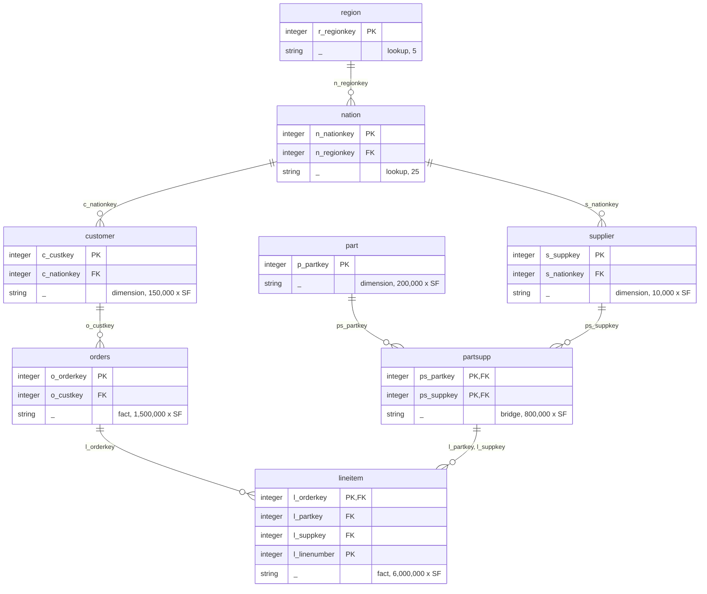
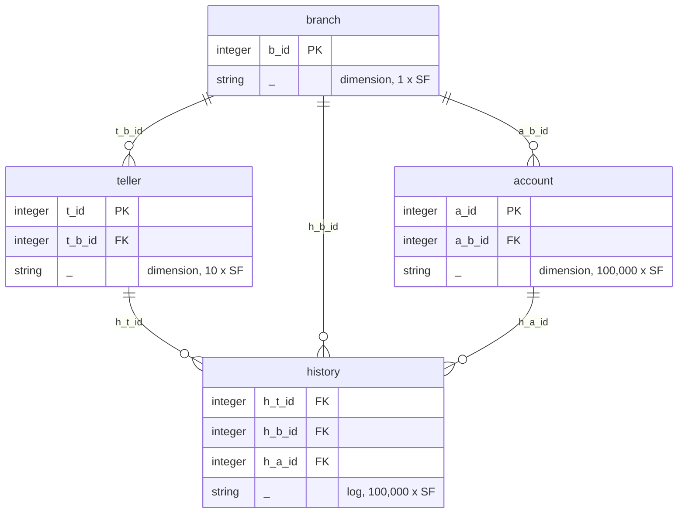
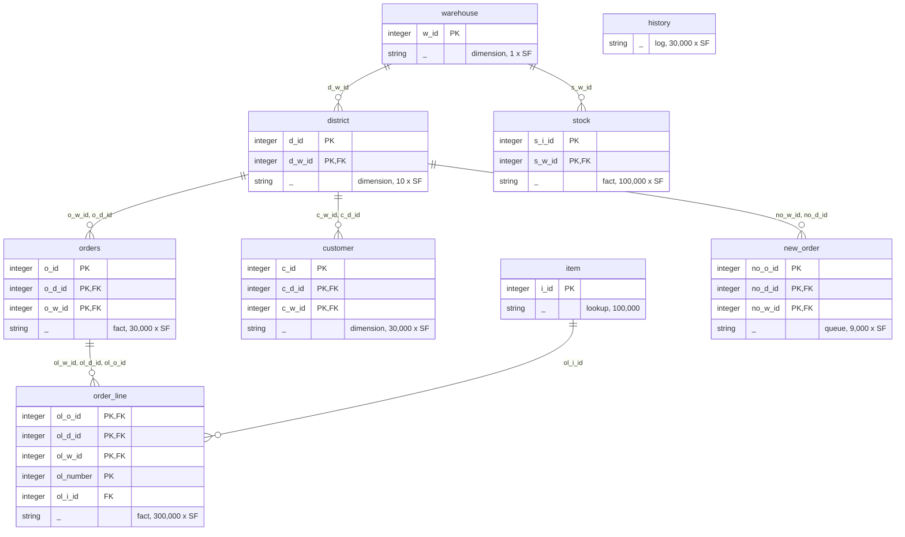

# The TPC models the tests use

Most tests fill their source databases with one of six TPC models, at a small scale factor (SF 0.001 unless a
test says otherwise), so each test's schema is a known, published one. These diagrams show each model's tables
and how they relate: the key columns only (primary keys PK, foreign keys FK), each table's role (fact,
dimension, lookup, bridge, log) and its rows (fixed, or per scale factor). The full schemas, with every column
and how the data is generated: [lfc-source-statschema schemas/](../skills/lfc-source-statschema/schemas/).
Back to the [README](../README.md).

Regenerate a diagram: `uv run skills/lfc-source-statschema/scripts/describe.py skills/lfc-source-statschema/schemas/<model>.yaml --mermaid`.

## TPC-H

TPC-H: a wholesale supplier's orders and line items, by part, supplier, customer and nation. Decision support: big fact tables (lineitem, orders) over small dimensions.

## TPC-B

TPC-B: a bank's branches, tellers and accounts, each change logged in history. Small, very busy tables: the update-heavy case.

## TPC-C

TPC-C: an order-entry business by warehouse and district: new orders, payments, deliveries, stock. Many small changes across related tables (OLTP).

## TPC-E

TPC-E: a brokerage: customers, accounts, trades, holdings, and market data. Many tables and foreign keys, a mix of reads and changes.

```mermaid
erDiagram
  exchange {
    varchar ex_id PK
    string _ "lookup, 4"
  }
  sector {
    varchar sc_id PK
    string _ "lookup, 12"
  }
  industry {
    varchar in_id PK
    varchar in_sc_id FK
    string _ "lookup, 102"
  }
  status_type {
    varchar st_id PK
    string _ "lookup, 5"
  }
  trade_type {
    varchar tt_id PK
    string _ "lookup, 5"
  }
  taxrate {
    varchar tx_id PK
    string _ "lookup, 320"
  }
  charge {
    varchar ch_tt_id PK
    integer ch_c_tier PK
    string _ "lookup, 15"
  }
  commission_rate {
    integer cr_c_tier PK
    varchar cr_tt_id PK
    varchar cr_ex_id PK
    integer cr_from_qty PK
    string _ "lookup, 240"
  }
  zip_code {
    varchar zc_code PK
    string _ "lookup, 14,741"
  }
  address {
    varchar ad_id PK
    string _ "dimension, 1,333,333 x SF"
  }
  customer {
    long c_id PK
    varchar c_st_id FK
    varchar c_ad_id FK
    string _ "dimension, 1,000,000 x SF"
  }
  customer_taxrate {
    varchar cx_tx_id PK,FK
    long cx_c_id PK,FK
    string _ "bridge, 3,000,000 x SF"
  }
  broker {
    long b_id PK
    varchar b_st_id FK
    string _ "dimension, 1,000 x SF"
  }
  customer_account {
    long ca_id PK
    long ca_b_id FK
    long ca_c_id FK
    string _ "dimension, 5,000,000 x SF"
  }
  account_permission {
    long ap_ca_id PK,FK
    varchar ap_acl PK
    string _ "bridge, 7,500,000 x SF"
  }
  watch_list {
    long wl_id PK
    long wl_c_id FK
    string _ "dimension, 1,000,000 x SF"
  }
  watch_item {
    long wi_wl_id PK,FK
    varchar wi_s_symb PK,FK
    string _ "bridge, 15,000,000 x SF"
  }
  company {
    long co_id PK
    varchar co_st_id FK
    varchar co_in_id FK
    varchar co_ad_id FK
    string _ "dimension, 5,000 x SF"
  }
  company_competitor {
    long cp_co_id PK,FK
    long cp_comp_co_id PK,FK
    varchar cp_in_id PK,FK
    string _ "bridge, 15,000 x SF"
  }
  security {
    varchar s_symb PK
    varchar s_st_id FK
    varchar s_ex_id FK
    long s_co_id FK
    string _ "dimension, 6,850 x SF"
  }
  financial {
    long fi_co_id PK,FK
    integer fi_year PK
    integer fi_qtr PK
    string _ "fact, 100,000 x SF"
  }
  news_item {
    long ni_id PK
    string _ "dimension, 20,000 x SF"
  }
  news_xref {
    long nx_ni_id PK,FK
    long nx_co_id PK,FK
    string _ "bridge, 60,000 x SF"
  }
  daily_market {
    date dm_date PK
    varchar dm_s_symb PK,FK
    string _ "fact, 12,502,750 x SF"
  }
  last_trade {
    varchar lt_s_symb PK,FK
    string _ "fact, 6,850 x SF"
  }
  trade {
    long t_id PK
    varchar t_st_id FK
    varchar t_tt_id FK
    varchar t_s_symb FK
    long t_ca_id FK
    string _ "fact, 3,338,760 x SF"
  }
  trade_history {
    long th_t_id PK,FK
    timestamp th_dts PK
    varchar th_st_id FK
    string _ "log, 10,000,000 x SF"
  }
  trade_request {
    long tr_t_id PK,FK
    varchar tr_tt_id FK
    varchar tr_s_symb FK
    long tr_b_id FK
    string _ "queue, 100,000 x SF"
  }
  holding {
    long h_t_id PK,FK
    long h_ca_id FK
    varchar h_s_symb FK
    string _ "fact, 5,000,000 x SF"
  }
  holding_history {
    long hh_h_t_id PK,FK
    long hh_t_id PK,FK
    string _ "log, 10,000,000 x SF"
  }
  holding_summary {
    long hs_ca_id PK,FK
    varchar hs_s_symb PK,FK
    string _ "fact, 3,800,000 x SF"
  }
  cash_transaction {
    long ct_t_id PK,FK
    string _ "fact, 3,338,760 x SF"
  }
  settlement {
    long se_t_id PK,FK
    string _ "fact, 3,338,760 x SF"
  }
  sector ||--o{ industry : "in_sc_id"
  status_type ||--o{ customer : "c_st_id"
  address ||--o{ customer : "c_ad_id"
  customer ||--o{ customer_taxrate : "cx_c_id"
  taxrate ||--o{ customer_taxrate : "cx_tx_id"
  status_type ||--o{ broker : "b_st_id"
  broker ||--o{ customer_account : "ca_b_id"
  customer ||--o{ customer_account : "ca_c_id"
  customer_account ||--o{ account_permission : "ap_ca_id"
  customer ||--o{ watch_list : "wl_c_id"
  watch_list ||--o{ watch_item : "wi_wl_id"
  security ||--o{ watch_item : "wi_s_symb"
  status_type ||--o{ company : "co_st_id"
  industry ||--o{ company : "co_in_id"
  address ||--o{ company : "co_ad_id"
  company ||--o{ company_competitor : "cp_co_id"
  company ||--o{ company_competitor : "cp_comp_co_id"
  industry ||--o{ company_competitor : "cp_in_id"
  company ||--o{ security : "s_co_id"
  status_type ||--o{ security : "s_st_id"
  exchange ||--o{ security : "s_ex_id"
  company ||--o{ financial : "fi_co_id"
  news_item ||--o{ news_xref : "nx_ni_id"
  company ||--o{ news_xref : "nx_co_id"
  security ||--o{ daily_market : "dm_s_symb"
  security ||--o{ last_trade : "lt_s_symb"
  customer_account ||--o{ trade : "t_ca_id"
  status_type ||--o{ trade : "t_st_id"
  trade_type ||--o{ trade : "t_tt_id"
  security ||--o{ trade : "t_s_symb"
  trade ||--o{ trade_history : "th_t_id"
  status_type ||--o{ trade_history : "th_st_id"
  trade ||--o{ trade_request : "tr_t_id"
  trade_type ||--o{ trade_request : "tr_tt_id"
  broker ||--o{ trade_request : "tr_b_id"
  security ||--o{ trade_request : "tr_s_symb"
  trade ||--o{ holding : "h_t_id"
  customer_account ||--o{ holding : "h_ca_id"
  security ||--o{ holding : "h_s_symb"
  trade ||--o{ holding_history : "hh_h_t_id"
  trade ||--o{ holding_history : "hh_t_id"
  customer_account ||--o{ holding_summary : "hs_ca_id"
  security ||--o{ holding_summary : "hs_s_symb"
  trade ||--o{ cash_transaction : "ct_t_id"
  trade ||--o{ settlement : "se_t_id"
```

## TPC-DS

TPC-DS: a retailer's store, catalog and web sales and returns over shared dimensions (date, item, customer). A star schema with many dimensions.

```mermaid
erDiagram
  date_dim {
    integer d_date_sk PK
    string _ "dimension, 73,049"
  }
  time_dim {
    integer t_time_sk PK
    string _ "dimension, 86,400"
  }
  customer_demographics {
    integer cd_demo_sk PK
    string _ "dimension, 1,920,800"
  }
  household_demographics {
    integer hd_demo_sk PK
    integer hd_income_band_sk FK
    string _ "dimension, 7,200"
  }
  income_band {
    integer ib_income_band_sk PK
    string _ "lookup, 20"
  }
  reason {
    integer r_reason_sk PK
    string _ "lookup, 55"
  }
  ship_mode {
    integer sm_ship_mode_sk PK
    string _ "lookup, 20"
  }
  item {
    integer i_item_sk PK
    string _ "dimension, 18,000 x SF"
  }
  warehouse {
    integer w_warehouse_sk PK
    string _ "dimension, 5"
  }
  store {
    integer s_store_sk PK
    string _ "dimension, 12"
  }
  call_center {
    integer cc_call_center_sk PK
    string _ "dimension, 6"
  }
  customer_address {
    integer ca_address_sk PK
    string _ "dimension, 50,000 x SF"
  }
  customer {
    integer c_customer_sk PK
    integer c_current_addr_sk FK
    string _ "dimension, 100,000 x SF"
  }
  promotion {
    integer p_promo_sk PK
    integer p_item_sk FK
    string _ "dimension, 300 x SF"
  }
  catalog_page {
    integer cp_catalog_page_sk PK
    string _ "dimension, 11,718 x SF"
  }
  web_site {
    integer web_site_sk PK
    string _ "dimension, 54"
  }
  web_page {
    integer wp_web_page_sk PK
    string _ "dimension, 2,040 x SF"
  }
  store_sales {
    integer ss_item_sk PK,FK
    integer ss_customer_sk FK
    integer ss_addr_sk FK
    integer ss_store_sk FK
    integer ss_promo_sk FK
    long ss_ticket_number PK
    string _ "fact, 2,880,404 x SF"
  }
  store_returns {
    integer sr_item_sk PK,FK
    integer sr_customer_sk FK
    integer sr_addr_sk FK
    integer sr_store_sk FK
    integer sr_reason_sk FK
    long sr_ticket_number PK
    string _ "fact, 287,514 x SF"
  }
  catalog_sales {
    integer cs_bill_customer_sk FK
    integer cs_bill_addr_sk FK
    integer cs_ship_customer_sk FK
    integer cs_call_center_sk FK
    integer cs_ship_mode_sk FK
    integer cs_warehouse_sk FK
    integer cs_item_sk PK,FK
    integer cs_promo_sk FK
    long cs_order_number PK
    string _ "fact, 1,441,548 x SF"
  }
  catalog_returns {
    integer cr_item_sk PK,FK
    integer cr_refunded_customer_sk FK
    integer cr_returning_customer_sk FK
    integer cr_reason_sk FK
    long cr_order_number PK
    string _ "fact, 144,067 x SF"
  }
  web_sales {
    integer ws_item_sk PK,FK
    integer ws_bill_customer_sk FK
    integer ws_bill_addr_sk FK
    integer ws_ship_customer_sk FK
    integer ws_web_page_sk FK
    integer ws_web_site_sk FK
    integer ws_ship_mode_sk FK
    integer ws_warehouse_sk FK
    integer ws_promo_sk FK
    long ws_order_number PK
    string _ "fact, 719,384 x SF"
  }
  web_returns {
    integer wr_item_sk PK,FK
    integer wr_refunded_customer_sk FK
    integer wr_returning_customer_sk FK
    integer wr_reason_sk FK
    long wr_order_number PK
    string _ "fact, 71,763 x SF"
  }
  inventory {
    integer inv_date_sk PK
    integer inv_item_sk PK,FK
    integer inv_warehouse_sk PK,FK
    string _ "fact, 11,745,000 x SF"
  }
  income_band ||--o{ household_demographics : "hd_income_band_sk"
  customer_address ||--o{ customer : "c_current_addr_sk"
  item ||--o{ promotion : "p_item_sk"
  item ||--o{ store_sales : "ss_item_sk"
  customer ||--o{ store_sales : "ss_customer_sk"
  customer_address ||--o{ store_sales : "ss_addr_sk"
  store ||--o{ store_sales : "ss_store_sk"
  promotion ||--o{ store_sales : "ss_promo_sk"
  item ||--o{ store_returns : "sr_item_sk"
  customer ||--o{ store_returns : "sr_customer_sk"
  customer_address ||--o{ store_returns : "sr_addr_sk"
  store ||--o{ store_returns : "sr_store_sk"
  reason ||--o{ store_returns : "sr_reason_sk"
  promotion ||--o{ catalog_sales : "cs_promo_sk"
  item ||--o{ catalog_sales : "cs_item_sk"
  customer ||--o{ catalog_sales : "cs_bill_customer_sk"
  customer ||--o{ catalog_sales : "cs_ship_customer_sk"
  customer_address ||--o{ catalog_sales : "cs_bill_addr_sk"
  call_center ||--o{ catalog_sales : "cs_call_center_sk"
  ship_mode ||--o{ catalog_sales : "cs_ship_mode_sk"
  warehouse ||--o{ catalog_sales : "cs_warehouse_sk"
  item ||--o{ catalog_returns : "cr_item_sk"
  customer ||--o{ catalog_returns : "cr_refunded_customer_sk"
  customer ||--o{ catalog_returns : "cr_returning_customer_sk"
  reason ||--o{ catalog_returns : "cr_reason_sk"
  promotion ||--o{ web_sales : "ws_promo_sk"
  item ||--o{ web_sales : "ws_item_sk"
  customer ||--o{ web_sales : "ws_bill_customer_sk"
  customer ||--o{ web_sales : "ws_ship_customer_sk"
  customer_address ||--o{ web_sales : "ws_bill_addr_sk"
  web_page ||--o{ web_sales : "ws_web_page_sk"
  web_site ||--o{ web_sales : "ws_web_site_sk"
  ship_mode ||--o{ web_sales : "ws_ship_mode_sk"
  warehouse ||--o{ web_sales : "ws_warehouse_sk"
  item ||--o{ web_returns : "wr_item_sk"
  customer ||--o{ web_returns : "wr_refunded_customer_sk"
  customer ||--o{ web_returns : "wr_returning_customer_sk"
  reason ||--o{ web_returns : "wr_reason_sk"
  item ||--o{ inventory : "inv_item_sk"
  warehouse ||--o{ inventory : "inv_warehouse_sk"
```

## TPC-DI

TPC-DI: a brokerage's data warehouse loaded from several source systems: dimensions with history (SCD type 2) and facts built from them.

```mermaid
erDiagram
  StatusType {
    string ST_ID PK
    string _ "lookup, 5"
  }
  TaxRate {
    string TX_ID PK
    string _ "lookup, 320"
  }
  TradeType {
    string TT_ID PK
    string _ "lookup, 5"
  }
  Industry {
    string IN_ID PK
    string _ "lookup, 102"
  }
  DimDate {
    bigint SK_DateID PK
    string _ "dimension, 3,652"
  }
  DimTime {
    bigint SK_TimeID PK
    string _ "dimension, 86,400"
  }
  DimCompany {
    bigint SK_CompanyID PK
    string _ "dimension, 400 x SF"
  }
  DimBroker {
    bigint SK_BrokerID PK
    string _ "dimension, 100 x SF"
  }
  DimSecurity {
    bigint SK_SecurityID PK
    bigint SK_CompanyID FK
    string _ "dimension, 685 x SF"
  }
  DimCustomer {
    bigint SK_CustomerID PK
    string _ "dimension, 950 x SF"
  }
  Prospect {
    string AgencyID PK
    bigint SK_RecordDateID FK
    bigint SK_UpdateDateID FK
    string _ "dimension, 4,000 x SF"
  }
  DimAccount {
    bigint SK_AccountID PK
    bigint SK_BrokerID FK
    bigint SK_CustomerID FK
    string _ "dimension, 1,500 x SF"
  }
  Financial {
    bigint SK_CompanyID PK,FK
    smallint FI_YEAR PK
    smallint FI_QTR PK
    string _ "fact, 3,200 x SF"
  }
  DimTrade {
    bigint TradeID PK
    bigint SK_BrokerID FK
    bigint SK_CreateDateID FK
    bigint SK_CreateTimeID FK
    bigint SK_CloseDateID FK
    bigint SK_CloseTimeID FK
    bigint SK_SecurityID FK
    bigint SK_CompanyID FK
    bigint SK_CustomerID FK
    bigint SK_AccountID FK
    string _ "dimension, 46,000 x SF"
  }
  FactMarketHistory {
    bigint SK_SecurityID PK,FK
    bigint SK_CompanyID FK
    bigint SK_DateID PK,FK
    bigint SK_FiftyTwoWeekHighDate FK
    bigint SK_FiftyTwoWeekLowDate FK
    string _ "fact, 57,000 x SF"
  }
  FactWatches {
    bigint SK_CustomerID PK,FK
    bigint SK_SecurityID PK,FK
    bigint SK_DateID_DatePlaced FK
    bigint SK_DateID_DateRemoved FK
    string _ "fact, 5,000 x SF"
  }
  FactHoldings {
    bigint TradeID PK,FK
    bigint CurrentTradeID FK
    bigint SK_CustomerID FK
    bigint SK_AccountID FK
    bigint SK_SecurityID FK
    bigint SK_CompanyID FK
    bigint SK_DateID FK
    bigint SK_TimeID FK
    string _ "fact, 3,000 x SF"
  }
  FactCashBalances {
    bigint SK_CustomerID PK,FK
    bigint SK_AccountID PK,FK
    bigint SK_DateID PK,FK
    string _ "fact, 3,000 x SF"
  }
  DimMessage {
    string _ "log, 500 x SF"
  }
  DimCompany ||--o{ DimSecurity : "SK_CompanyID"
  DimDate ||--o{ Prospect : "SK_RecordDateID"
  DimDate ||--o{ Prospect : "SK_UpdateDateID"
  DimBroker ||--o{ DimAccount : "SK_BrokerID"
  DimCustomer ||--o{ DimAccount : "SK_CustomerID"
  DimCompany ||--o{ Financial : "SK_CompanyID"
  DimSecurity ||--o{ DimTrade : "SK_SecurityID"
  DimCompany ||--o{ DimTrade : "SK_CompanyID"
  DimCustomer ||--o{ DimTrade : "SK_CustomerID"
  DimAccount ||--o{ DimTrade : "SK_AccountID"
  DimBroker ||--o{ DimTrade : "SK_BrokerID"
  DimDate ||--o{ DimTrade : "SK_CreateDateID"
  DimTime ||--o{ DimTrade : "SK_CreateTimeID"
  DimDate ||--o{ DimTrade : "SK_CloseDateID"
  DimTime ||--o{ DimTrade : "SK_CloseTimeID"
  DimSecurity ||--o{ FactMarketHistory : "SK_SecurityID"
  DimCompany ||--o{ FactMarketHistory : "SK_CompanyID"
  DimDate ||--o{ FactMarketHistory : "SK_DateID"
  DimDate ||--o{ FactMarketHistory : "SK_FiftyTwoWeekHighDate"
  DimDate ||--o{ FactMarketHistory : "SK_FiftyTwoWeekLowDate"
  DimCustomer ||--o{ FactWatches : "SK_CustomerID"
  DimSecurity ||--o{ FactWatches : "SK_SecurityID"
  DimDate ||--o{ FactWatches : "SK_DateID_DatePlaced"
  DimDate ||--o{ FactWatches : "SK_DateID_DateRemoved"
  DimTrade ||--o{ FactHoldings : "TradeID"
  DimTrade ||--o{ FactHoldings : "CurrentTradeID"
  DimCustomer ||--o{ FactHoldings : "SK_CustomerID"
  DimAccount ||--o{ FactHoldings : "SK_AccountID"
  DimSecurity ||--o{ FactHoldings : "SK_SecurityID"
  DimCompany ||--o{ FactHoldings : "SK_CompanyID"
  DimDate ||--o{ FactHoldings : "SK_DateID"
  DimTime ||--o{ FactHoldings : "SK_TimeID"
  DimCustomer ||--o{ FactCashBalances : "SK_CustomerID"
  DimAccount ||--o{ FactCashBalances : "SK_AccountID"
  DimDate ||--o{ FactCashBalances : "SK_DateID"
```

