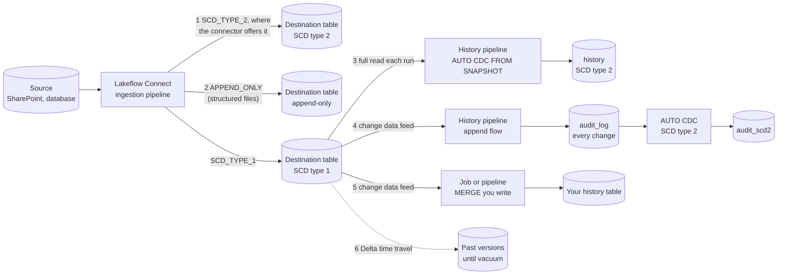
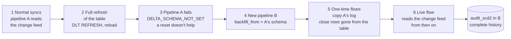

# History downstream of a Lakeflow Connect table

Some connectors write only SCD type 1 or append-only tables (SharePoint files: `SCD_TYPE_1`; structured files: `APPEND_ONLY`), and a full refresh empties and reloads a table. When a customer needs history anyway, there are several routes. **Pick the simplest one that survives the events the customer will hit**, and test it through those events before offering it: a route that works only until the first full refresh is a limitation, not an answer.

## Routes, simplest first

| # | Route | Setup | Operation | Full refresh of the table | Tested |
|---|---|---|---|---|---|
| 1 | The connector's own SCD type 2 | One setting | None | The connector's documented behavior | Per connector: check its docs |
| 2 | Append-only table (structured files) | None | None | History lost | Docs |
| 3 | [AUTO CDC FROM SNAPSHOT](#3-auto-cdc-from-snapshot) | One pipeline, 5 lines | Full scan per run | Keeps working, nothing to do | Yes: 6 of 6 claims |
| 4 | [Change feed → log + AUTO CDC](#4-change-feed-into-a-log-and-auto-cdc) | One pipeline, ~60 lines | Recovery pipeline after a refresh | Breaks the reader; recover | Yes: 6 of 6 claims |
| 5 | MERGE written by hand | Most code | You own ordering, deletes, replays | Your code decides | Debezium silver (below) |
| 6 | Delta time travel | None | Within the retention window | Versions kept until vacuum | Docs |

Rows 1, 2 and 6 aren't pipelines you build; check the connector's docs for 1 and 2. Rows 3 to 5 are. **Pick: route 3** where the connector has no SCD type 2: the simplest to set up, and nothing to do after a full refresh. Route 4 only when a full table scan per run costs too much (a large table, frequent runs): it reads only the changes. The ranked comparison is [options.yaml](options.yaml) (**options-first** `options.py render`).

## Data paths

## 3. AUTO CDC FROM SNAPSHOT

A pipeline of its own reads the whole destination table on each update and compares it with the previous snapshot: a new or changed row opens a version, a missing row closes one ([AUTO CDC FROM SNAPSHOT](https://docs.databricks.com/ldp/cdc#cdc-from-snapshot)). It doesn't read the change feed, so the change feed's break on a full refresh doesn't apply.

- Code: [scripts/history-snapshot.py](scripts/history-snapshot.py) (settings `src`, `keys`).
- Harness: [scripts/sqlserver-history-snapshot.sh](scripts/sqlserver-history-snapshot.sh), the same lifecycle and expected history as route 4's, plus history runs while the full refresh is applied and the row count a snapshot would read at each version of the refresh.
- Costs: each run scans the whole table; edits between two runs collapse into one version; a delete is a row missing from the snapshot.

Result, through the same lifecycle and expected history as route 4 (6 of 6 claims):

- Load and a normal sync: the update, the delete and the insert each open or close a version.
- A gap (changes ingested while the history pipeline doesn't run): picked up at the next run, as the state then.
- Full refresh of the table, with 17 history runs back to back while it was applied: every run completed, and the history after it is exactly the expected one, with no spurious versions and no recovery. One run fell in a moment when the table had no schema (a query on it failed with `UNRESOLVED_COLUMN`); it did no harm.
- The next change: a new version. A run with nothing new: no change.
- Reading the table `VERSION AS OF` the refresh's versions fails with `STREAMING_TABLE_NEEDS_REFRESH`, so the runs during the refresh are the evidence, not a time-travel probe.

## 4. Change feed into a log and AUTO CDC

A pipeline of its own reads the destination's change data feed into an append-only `audit_log` and builds an SCD type 2 table from it with AUTO CDC.

- Code and harness: **lfc-schema-change-test** `scripts/audit-history.py` and `scripts/sqlserver-cdf-history-recovery.sh`.
- Normal syncs: updates, deletes and inserts are all captured.
- Full refresh of the table: the reader fails with `DELTA_SCHEMA_NOT_SET` (also `DELTA_STREAMING_CANNOT_CONTINUE_PROCESSING_POST_SCHEMA_EVOLUTION`) and retries on its own; `reset_checkpoint_selection`, a `startingVersion` after the refresh and renamed views don't fix it. `table_changes()` across the refresh fails with `DELTA_CHANGE_DATA_FEED_INCOMPATIBLE_DATA_SCHEMA`; after it, the reload is inserts only.
- Recovery: a new pipeline with the same code and `backfill_from` set to the old schema copies the old log once, writes a delete for every row gone from the table, and continues; reruns don't repeat the one-time flows. Changes between the old pipeline's last run and the refresh show only as the state at the refresh.

## 5. MERGE

**zerobus-debezium-test** builds silver with AUTO CDC and, as an alternative, with MERGE (`scripts/merge-silver.py`): what MERGE has to carry by hand (tombstones, sequence and idempotency columns, replay handling) is in its `references/trade-offs.md`, and `scripts/scd2-history-check.py` checks every SCD type 2 version against the source. Reach for MERGE only when routes 3 and 4 can't express the rule.

## Testing a route

Run it through: a load, a normal sync (an update, a delete, an insert), a gap (changes ingested while the history pipeline doesn't run), a full refresh of the destination table, history runs during and after the refresh, the next change, and a run with nothing new. With integrated CDC a full refresh is two updates (re-read, then apply): run both with `EARLY_STOP=0`. Needs and options of the harness scripts: as **lfc-schema-change-test** `lib.sh`; run a script with no arguments for its usage.
